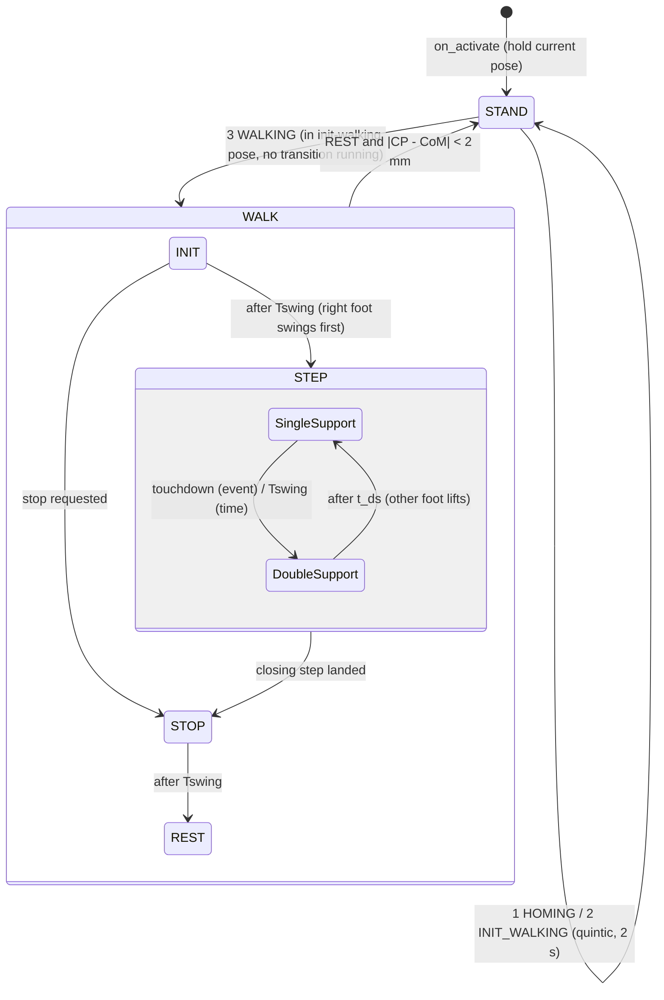
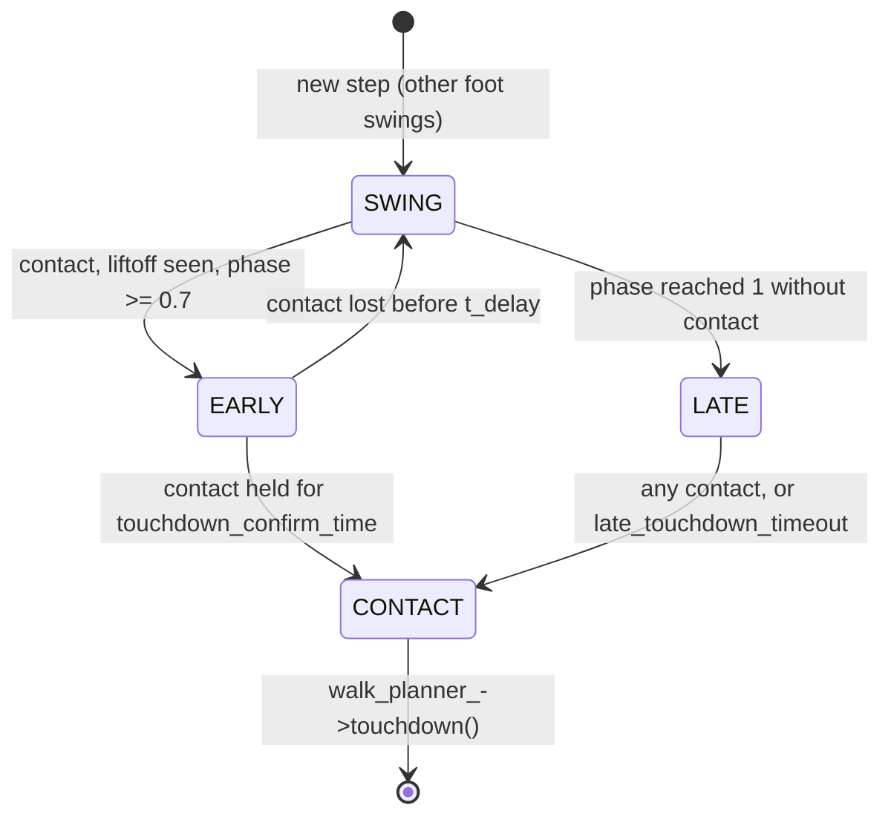

# biped_controllers

ros2_control controllers for the 12-motor biped. They run inside the `controller_manager` loop
(500 Hz) together with the hardware interface `biped_hardware/BipedSystem`.

| Controller | Plugin | Use |
|---|---|---|
| `joint_jogging_controller` | `biped_controllers/JointJoggingController` | Move joints with `joint_state_publisher_gui` sliders, slowly and smoothly. Test tool for the hardware interface. |
| `wbc_controller` | `biped_controllers/WBCController` | Whole-body controller: state estimation, contact fusion, LIP walk planner, TSID. See [wbc_controller: logic FSM](#wbc_controller-logic-fsm). |

## joint_jogging_controller

```bash
ros2 launch biped_bringup hardware.launch.py slider:=true
```

That launch activates the hardware, spawns the controller and opens the sliders (remapped to
`/slider_joint_states`, because `/joint_states` is the real robot).

**Interfaces**

| | Per joint | Extra |
|---|---|---|
| Command (claimed) | `position`, `velocity`, `effort` | – |
| State | `position` | `BipedSystem/enabled` |

**Each cycle (`update()`)**, per joint:

1. goal = slider value if that slider has been moved since activation, else the pose it started at
2. rate limit: the target moves at most `max_velocity · dt` toward the goal
3. first-order low-pass with `filter_time_constant`
4. writes position = filtered target, velocity = 0, effort = 0

The motors track the position with their own kp / kd (the hardware sends PVT frames only).

**Safety**

- On activation every target starts at the measured position.
- A joint follows its slider only after that slider has been moved (the GUI starts all sliders
  at 0, untouched joints keep their pose).
- While `BipedSystem/enabled` is 0 (motors disabled), the target follows the measured position.
  Humble lets the controller be active while the hardware is inactive; without this, moving a leg
  by hand and then enabling the motors would make them jump back to the old pose.
- The subscription runs in a normal thread and hands the slider values to `update()` through a
  `realtime_tools::RealtimeBuffer`: no locks and no allocation in the real-time loop.

**Parameters** (`biped_bringup/config/controllers.yaml`)

| Name | Default | Meaning |
|---|---|---|
| `joints` | – (required) | joints to command |
| `slider_topic` | `/slider_joint_states` | `sensor_msgs/JointState` with the slider values |
| `max_velocity` | 0.3 rad/s | how fast a joint moves toward its slider |
| `filter_time_constant` | 0.1 s | low-pass after the rate limit (0 = off) |
| `enabled_interface` | `BipedSystem/enabled` | state interface that is 1 while the motors are enabled (empty = not used) |

## wbc_controller: logic FSM

```bash
ros2 launch biped_bringup sim_tsid_wbc.launch.py lockstep:=true
ros2 run remote_control keyboard_motion_command   # 1 homing, 2 init walking, hold walk key, Ctrl+A / Ctrl+D turn
```

The controller is four state machines nested in each other. Each one runs inside the one above it:

| Level | States | Where |
|---|---|---|
| 1. Cycle guard | motors off / bad reading / control | `update()` |
| 2. Motion mode | `STAND` (homing, init walking transitions) ↔ `WALK` | `handleMotionCommand()`, `computeCommand()` |
| 3. Walk phase (planner) | `INIT` → `STEP` (single ↔ double support) → `STOP` → `REST` | `WalkPlanner::planWalking()` |
| 4. Swing contact (event mode) | `SWING` → `EARLY` / `LATE` → `CONTACT` | `computeWalkCommand()` |



Files: [wbc_controller.cpp](src/wbc_controller/wbc_controller.cpp),
[WalkPlanner.cpp](../biped_wbc_core/src/planner/WalkPlanner.cpp).

### 1. Cycle guard: `update()`

Every cycle (500 Hz), before any control:

- If the motors are disabled (a fault, or a command timeout), it holds the measured position, so
  nothing jumps when they are enabled again.
- If a reading has NaN / Inf, it resends the last command.
- Otherwise it runs: estimate → motion command → compute → write.
- If the TSID QP fails, it also resends the last command. The drives must get a command every
  cycle.

```cpp
if (!this->robot_ros_interface_->motorsEnabled())
{
    this->robot_ros_interface_->holdMeasured();
    return controller_interface::return_type::OK;
}
if (!this->robot_ros_interface_->read(this->sensor_))
{
    this->robot_ros_interface_->writeLastCommand();
    return controller_interface::return_type::OK;
}

this->estimate();                  // base state (IMU + leg kinematics), contact fusion
this->publishDebug();
this->handleMotionCommand(time);   // level 2: may start a transition / walking

if (this->computeCommand(time))    // levels 2-4, TSID
{
    this->robot_ros_interface_->write(this->q_cmd_, this->v_cmd_, this->tau_cmd_);
}
else
{
    this->robot_ros_interface_->writeLastCommand();
}
```

`estimate()` uses the contact the controller decided on in the last cycle (`scheduled_contact_`)
for the leg kinematics. It does not use the fused probability, because that lags the liftoff. The
fusion then computes the contact probability that the swing FSM (level 4) reads in this cycle:

```cpp
this->state_estimator_->update(this->sensor_, planned_contact);   // from scheduled_contact_
this->contact_fusion_->computeDisturbanceTorque(this->q_, this->v_, this->sensor_.actuator_state.torquej);
this->contact_probability_ =
    this->contact_fusion_->fuseContactProbability(this->scheduled_contact_, this->contact_phase_);
```

### 2. Motion mode: `STAND` ↔ `WALK`

Commands come from `humanoid_mpc_msgs/MotionCommand`, sent by the keyboard or joystick:

| Command | Action | Allowed when |
|---|---|---|
| 1 `HOMING` | quintic (2 s) of all joints to 0, CoM to that pose's CoM | `STAND`, no transition running |
| 2 `INIT_WALKING` | quintic (2 s) to the IK pose, base `kStandBaseHeight`, knees bent | `STAND`, no transition running |
| 3 `WALKING` | start walking; sent again at 20 Hz to keep walking | init-walking pose reached; while `WALK` it only refreshes the timer |

`handleMotionCommand()` reacts only to new messages (`seq`), and runs one transition at a time:

```cpp
if (cmd.command == humanoid_mpc_msgs::msg::MotionCommand::WALKING)
{
    this->walk_cmd_time_ = time.seconds();        // keeps walking alive
    if (this->mode_ == Mode::WALK) return;
    if (transition_running || !this->in_walking_pose_) return;   // warned: send init walking first
    this->startWalking(time);                     // STAND -> WALK
    return;
}
if (this->mode_ == Mode::WALK) return;           // 1 / 2 ignored while walking
if (transition_running) return;                   // one transition at a time

switch (cmd.command)
{
case humanoid_mpc_msgs::msg::MotionCommand::HOMING:
    this->startTransition(this->qj_home_, this->com_home_in_foot_, time);
    this->in_walking_pose_ = false;
    break;
case humanoid_mpc_msgs::msg::MotionCommand::INIT_WALKING:
    this->startTransition(this->qj_stand_, this->com_stand_in_foot_, time);
    this->in_walking_pose_ = true;
    break;
}
```

**`STAND`** (`computeCommand()`): it tracks a quintic from the last reference to the target. Once
the transition is done it holds the target. TSID runs with both feet in contact, and the drive
tracks the joint reference with the TSID torque as feedforward:

```cpp
if (this->mode_ == Mode::WALK)
{
    return this->computeWalkCommand(time);
}
utils::quinticTrajectory(this->qj_start_, this->qj_target_, t, kTransitionDuration, this->qj_ref_, ...);
this->qp_tsid_controller_->setPostureReference(this->qj_ref_, this->dqj_ref_, this->ddqj_ref_);
utils::quinticTrajectory(this->com_start_, this->com_target_, t, kTransitionDuration, this->com_ref_, ...);
this->qp_tsid_controller_->setCoMReference(this->com_ref_, this->dcom_ref_, this->ddcom_ref_);
// solve -> q_cmd_ = qj_ref_, v_cmd_ = dqj_ref_, tau_cmd_ = tau_
```

**`STAND` → `WALK`** (`startWalking()`): the planner is reset from the estimated state, and event
mode is chosen. The base yaw starts at the planner's yaw, halfway between the feet:

```cpp
this->walk_planner_->reset(this->q_);
this->walk_planner_->setWaitForTouchdown(!this->params_.use_time_base);  // event based: late steps wait
this->prev_swing_foot_ = -1;
this->swing_state_ = SwingState::SWING;
this->mode_ = Mode::WALK;
this->stop_requested_ = false;
```

**Stop request** (start of `computeWalkCommand()`): if no `WALKING` message arrives for
`kWalkTimeout` (0.3 s), the planner finishes the current step and stops. The turn command
(`WalkingVelocityCommand.angular_velocity_z` in [-1, 1], times `max_yaw_rate`) times out the same
way. While a turn is commanded, the step length is 0, so the robot turns in place:

```cpp
if (!this->stop_requested_ && time.seconds() - this->walk_cmd_time_ > kWalkTimeout)
{
    this->walk_planner_->requestStop();
    this->stop_requested_ = true;
}
const double turn_cmd = time.seconds() - this->turn_cmd_time_ <= kWalkTimeout ? this->turn_cmd_ : 0.0;
this->walk_planner_->setYawRateCommand(turn_cmd * this->params_.max_yaw_rate);
this->walk_planner_->setVelocityCommand(turn_cmd != 0.0 ? 0.0 : this->params_.walk_vx);
this->walk_planner_->planWalking(this->q_, this->v_);   // level 3
```

**`WALK` → `STAND`** (end of `computeWalkCommand()`): the robot is at `REST` and the planned CoM
has reached its capture point (within `kRestTolerance`, 2 mm). Every reference is then held where
it is, so the next command 1 / 2 starts from there:

```cpp
const Eigen::Vector2d com_to_cp = this->walk_planner_->getRefCP() - this->com_ref_.head<2>();
if (this->walk_planner_->getWalkPhase() == WalkPhase::REST && com_to_cp.norm() < kRestTolerance)
{
    this->mode_ = Mode::STAND;
    this->qj_ref_ = this->q_des_;  this->qj_start_ = this->q_des_;  this->qj_target_ = this->q_des_;
    this->com_start_ = this->com_ref_;  this->com_target_ = this->com_ref_;
    this->scheduled_contact_.assign(2, true);
}
```

### 3. Walk phase: `WalkPlanner::planWalking()`

Each cycle it does three things:

1. It measures the capture point (CP feedback).
2. It plans one LIP cycle toward the CP target of the current phase, in the time left
   (`phaseTarget()`).
3. It advances the phase timer and handles the phase's events.

`STEP` has two sub-phases: single support (`isSwinging()`) and double support
(`inDoubleSupport()`, `in_ds_`).

| Phase | CP target (support frame) | Ends |
|---|---|---|
| `INIT` | stance ankle + CoM bias | after Tswing → `STEP` (right foot swings first), or `STOP` if a stop was requested |
| `STEP`, double support | periodic-gait CP at the start of single support (`cp_start`) | after `t_ds` → single support |
| `STEP`, single support | `E_ss · cp_start` (the last step: between the feet) | touchdown (event) or Tswing (time) → `endStep()` |
| `STOP` | middle of the feet + CoM bias | after Tswing → `REST` |
| `REST` | same | stays; level 2 switches back to `STAND` |

```cpp
this->measureCP(q, v);
const double t_rem = this->phaseTarget(cp_target, zmp_min, zmp_max);
this->lip_.planCycle(cp_target, t_rem, zmp_min, zmp_max);
this->phase_time_ += this->lip_.getDt();

if (this->inDoubleSupport())
{
    if (this->phase_time_ >= this->t_ds_)           // double support over: trailing foot lifts off
    {
        this->in_ds_ = false;
        this->phase_time_ = 0.0;
        this->touchdown_ = false;
    }
}
else if (this->phase_ == WalkPhase::STEP)
{
    const bool swing_end = this->phase_time_ >= this->T_;
    if (this->touchdown_ || (swing_end && !this->wait_touchdown_))
    {
        this->endStep(q, v);                        // touchdown (event) or Tswing (time based)
    }
    else
    {
        this->adaptFoothold(cp_target);             // step goes on: foothold for the predicted CP
    }
}
else if (this->phase_time_ >= this->T_)
{
    this->endOfPhase(q, v);                         // INIT -> STEP / STOP, STOP -> REST
}

// late: still swinging after Tswing without touchdown (event mode only); the swing foot descends
this->late_ = this->isSwinging() && this->phase_time_ >= this->T_;
this->late_time_ = this->late_ ? this->phase_time_ - this->T_ : 0.0;
```

`endStep()` switches the support foot. If a stop was requested, it plans a closing step with no
step length, so the feet end side by side. After the closing step lands, it goes to `STOP`.
Otherwise double support starts:

```cpp
this->switchSupport(q, v, false);                   // landed foot becomes the stance foot
if (this->last_step_)
{
    this->startStop();                              // -> STOP
    return;
}
if (this->stop_requested_)
{
    this->last_step_ = true;                        // closing step
    this->step_h_.x() = 0.0;
    this->setNominalFoothold();
}
this->in_ds_ = this->t_ds_ > 0.0;                   // -> double support
```

`endOfPhase()`:

```cpp
case WalkPhase::INIT:
    if (this->stop_requested_) this->startStop();
    else { this->switchSupport(q, v, true); this->phase_ = WalkPhase::STEP; this->in_ds_ = false; }
    break;
case WalkPhase::STOP:
    this->phase_ = WalkPhase::REST;
    break;
```

With `use_time_base: true` a step ends at Tswing. With `false` (`setWaitForTouchdown(true)`) it
ends only when level 4 calls `touchdown()`. If Tswing passes without a touchdown, the step is
**late**: the step waits, and the swing reference keeps descending below the foothold
(`late_descent_*`).

### 4. Swing contact FSM (event mode): `computeWalkCommand()`

This follows Bledt et al., ICRA 2018, Sec. VI. It runs only when `use_time_base: false`, during
single support, until the touchdown is confirmed. Its input is the fused contact state of the
swing foot, computed by `estimate()` in this cycle.



| State | Swing foot in TSID | Fusion prior (`scheduled_contact_`, `contact_phase_`) |
|---|---|---|
| `SWING` | swing task on the planner trajectory | not in contact, swing phase |
| `EARLY` | swing task holding the touchdown pose (flat, planned yaw), zero velocity | not in contact, swing phase |
| `LATE` | swing task, the planner reference descends below the foothold | **in contact** (s_φ = 1), phase = late time / Tswing |
| `CONTACT` | contact task (`landFoot`) | in contact |

**Reset at each new step.** `liftoff_seen_` makes sure a contact still reported just after liftoff
is not taken as a touchdown:

```cpp
if (swinging && swing_foot != this->prev_swing_foot_)
{
    this->liftoff_seen_ = false;
    this->swing_state_ = SwingState::SWING;
}
```

**Transitions:**

```cpp
if (!this->params_.use_time_base && swinging && this->swing_state_ != SwingState::CONTACT)
{
    const bool contact = this->contact_fusion_->getContactState(swing_foot);
    const double phase = this->walk_planner_->getPhase();
    this->liftoff_seen_ = this->liftoff_seen_ || !contact;

    if (this->swing_state_ == SwingState::SWING)
    {
        if (this->liftoff_seen_ && contact && phase >= kMinTouchdownPhase)   // SWING -> EARLY
        {
            this->swing_state_ = SwingState::EARLY;
            this->early_start_time_ = time.seconds();
            this->hold_pose_.translation() = this->qp_tsid_controller_->getFootPose(swing_foot).translation();
            this->hold_pose_.rotation() = this->walk_planner_->getRefSwingFootRotation();
        }
        else if (this->walk_planner_->isLate())                             // SWING -> LATE
        {
            this->swing_state_ = SwingState::LATE;
        }
    }
    else if (this->swing_state_ == SwingState::LATE)
    {
        const double late_time = this->walk_planner_->getLateTime();
        if (contact)                                                         // LATE -> CONTACT
        {
            this->swing_state_ = SwingState::CONTACT;
        }
        else if (this->params_.late_touchdown_timeout > 0.0 && late_time >= this->params_.late_touchdown_timeout)
        {
            this->swing_state_ = SwingState::CONTACT;                        // timeout: land in the air
        }
    }
    else if (!contact)                                                       // EARLY -> SWING
    {
        this->swing_state_ = SwingState::SWING;
    }
    else if (time.seconds() - this->early_start_time_ >= this->params_.touchdown_confirm_time)
    {
        this->swing_state_ = SwingState::CONTACT;                            // EARLY -> CONTACT
    }

    if (this->swing_state_ == SwingState::CONTACT)
    {
        this->walk_planner_->touchdown();      // level 3 ends the step in its next cycle
    }
}
this->prev_swing_foot_ = swinging ? swing_foot : -1;
const bool in_swing = swinging && this->swing_state_ != SwingState::CONTACT;
```

**Contacts and fusion prior for the next `estimate()`.** A foot lands first, then the other lifts,
so TSID always has a contact:

```cpp
for (int i = 0; i < 2; ++i) // i = 0 left, 1 right foot
{
    const bool in_contact = !(in_swing && swing_foot == i);
    if (in_contact && !this->qp_tsid_controller_->isContactActive(i))
    {
        this->qp_tsid_controller_->landFoot(i);
    }
    const bool late_foot = !in_contact && this->swing_state_ == SwingState::LATE;
    this->scheduled_contact_[i] = in_contact || late_foot;
    this->contact_phase_[i] = late_foot  ? this->walk_planner_->getLateTime() / this->walk_planner_->getTswing()
                              : swinging ? this->walk_planner_->getPhase()
                                         : 0.5;
}
```

**Swing reference.** In `EARLY` the foot is held still. Otherwise it follows the planner, including
the late descent and the yaw while turning. After the swing reference is set, the foot's contact
is removed:

```cpp
if (in_swing)
{
    if (this->swing_state_ == SwingState::EARLY)
    {
        this->swing_pose_ = this->hold_pose_;
        this->swing_vel_.setZero();
        this->swing_acc_.setZero();
    }
    else
    {
        this->swing_pose_.translation() = this->walk_planner_->getRefSwingFootPosition();
        // ... rotation, velocity, acceleration, yaw rate / acceleration of the planner
    }
    this->qp_tsid_controller_->setSwingReference(swing_foot, this->swing_pose_, this->swing_vel_, this->swing_acc_);
    if (this->qp_tsid_controller_->isContactActive(swing_foot))
    {
        this->qp_tsid_controller_->liftFoot(swing_foot);
    }
}
```

### 5. Output while walking: TSID → PVT command

The base yaw (the mean of the two feet's yaw) and the planner's CoM are set as references. Then
TSID is solved, and the result is integrated one cycle from the measured state. The feedforward
torque is the TSID torque minus the PD the drive will apply, so in total the drive applies the
TSID torque. With `torque_mode: true` the drive gains are 0 and `tau_ff = tau`:

```cpp
const double dt = this->dt_;
const auto qj = this->q_.tail(na), vj = this->v_.tail(na), dvj = this->dv_.tail(na);
this->v_des_ = vj + dt * dvj;
this->q_des_ = qj + dt * vj + (0.5 * dt * dt) * dvj;
this->q_cmd_ = this->q_des_;
this->v_cmd_ = this->v_des_;
if (this->params_.torque_mode)
{
    this->tau_cmd_ = this->tau_;
}
else
{
    this->tau_cmd_ = this->tau_ - (this->drive_kp_.cwiseProduct(this->q_des_ - qj) +
                                   this->drive_kd_.cwiseProduct(this->v_des_ - vj));
}
```

`drive_kp_` / `drive_kd_` are read from `robot_description` (`loadDriveGains()`). They are the
gains of `biped_hardware/config/joint_gains.yaml`. For parallel ankles, each ankle joint uses the
sum of the two ankle motors' gains.

### Parameters of the logic

`biped_bringup/config/controllers_sim_floating.yaml` / `controllers.yaml`:

| Name | Meaning |
|---|---|
| `use_time_base` | `true`: steps end at Tswing; `false`: event based (level 4) |
| `touchdown_confirm_time` | [s] `EARLY` → `CONTACT` confirmation time (t_delay) |
| `late_touchdown_timeout` | [s] longest `LATE` wait before landing anyway (0 = wait forever) |
| `walk_vx` | [m/s] walking speed, step length = `walk_vx · Tswing` |
| `max_yaw_rate` | [rad/s] yaw rate at turn command 1 |
| `torque_mode` | `true`: effort only (drive kp = kd = 0); `false`: PVT with `tau_ff = tau − PD` |

Constants in `wbc_controller.hpp`:

| Name | Value | Meaning |
|---|---|---|
| `kTransitionDuration` | 2.0 s | homing / init walking quintic |
| `kWalkTimeout` | 0.3 s | no `WALKING` (or turn) message for this long → stop (turn 0) |
| `kRestTolerance` | 2 mm | planned CoM to CP at `REST` → back to `STAND` |
| `kMinTouchdownPhase` | 0.7 | earlier contacts are ignored (no `EARLY`) |

The planner's timing and the late descent come from `biped_bringup/config/tsid_wbc.yaml`, section
`LIPPlanner`: `double_support_time`, `late_descent_*`, `swing_landing_depth`, `cp_feedback_gain`,
`foothold_*`, `max_turn_per_step`.
